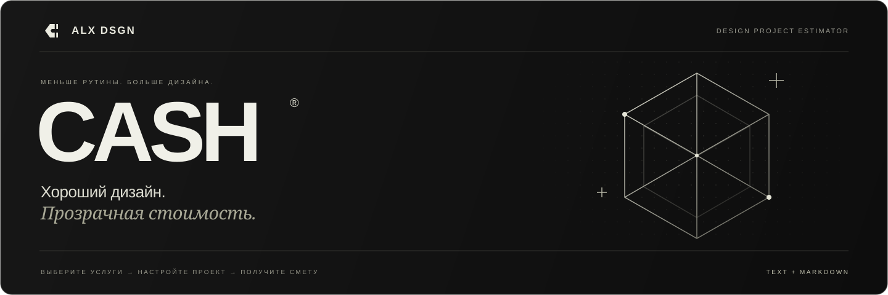

<div align="center">



<br />

**Калькулятор стоимости дизайн-проектов.**  
От выбора услуг до готовой сметы — в одном рабочем пространстве.

### [Открыть демо ↗](https://prorokads.github.io/Cash/)

Попробуйте калькулятор прямо в браузере — без установки и регистрации.

<br />


<br />

[Возможности](#возможности) · [Быстрый старт](#быстрый-старт) · [Расчёт стоимости](#расчёт-стоимости) · [Разработка](#разработка)

</div>

<br />

## Меньше рутины. Больше дизайна.

CASH помогает оценить дизайн-проект и объяснить клиенту, из чего складывается стоимость. Вы выбираете формат, объём и дополнительные работы — калькулятор сразу обновляет бюджет и ориентировочный срок.

В результате получается подробная смета: её можно скопировать, скачать в Markdown или сохранить в аккаунте для дальнейшего редактирования.

> [!NOTE]
> В публичном демо сметы и тарифы сохраняются в браузере посетителя. Локальная серверная версия поддерживает аккаунты. Начальные цены — примеры: настройте их под свой прайс перед подготовкой клиентских смет.

## Возможности

- **Проект по деталям.** Лендинги, многостраничные сайты, веб- и мобильные приложения; количество блоков, страниц или экранов.
- **Нужный состав работ.** Адаптивы, UX-исследование, прототип, UI-kit, айдентика и сопровождение разработки. Отдельно — дизайн форм, кабинета, каталога и оформления заказа.
- **Прозрачная стоимость.** Базовый пакет, дополнительный объём, срочность и скидка показаны отдельными строками.
- **Документ для клиента.** Предпросмотр, копирование текста и Markdown, скачивание `.md` с детализацией работ и условиями.
- **Личное пространство.** Авторизация, сохранение и редактирование смет, поиск по проектам и клиентам.
- **Свой прайс.** Редактируемые тарифы. Каждая смета хранит собственный снимок цен.

### От идеи до сметы

1. **Выберите проект** — например, лендинг для кофейни.
2. **Настройте объём** — количество блоков и необходимые услуги.
3. **Задайте условия** — срочность, скидку и примечания.
4. **Заберите смету** — скопируйте текст, скачайте `.md` или сохраните расчёт.

## Быстрый старт

Понадобятся **Node.js 24+**, npm и Git.

```sh
git clone https://github.com/prorokads/Cash.git
cd Cash
npm ci
npm run dev
```

Откройте **[127.0.0.1:5173](http://127.0.0.1:5173/)**.

Одна команда запускает интерфейс и API. Серверы доступны только на этом компьютере; остановка — `Ctrl+C`.

- Интерфейс: `http://127.0.0.1:5173`
- API: `http://127.0.0.1:3001`

Для первого локального входа нажмите **«Войти» → «Регистрация»**. Готового логина и пароля нет. Калькулятор и экспорт доступны без регистрации; аккаунт нужен для сохранения смет и тарифов.

## Расчёт стоимости

```text
Базовый пакет + дополнительный объём + выбранные услуги
                          ↓
                Наценка за срочность
                          ↓
                     Скидка
                          ↓
                 Итоговая стоимость
```

В базовый пакет входит определённое количество блоков, страниц или экранов. Дополнительный объём оплачивается поштучно.

- **Стандарт:** без наценки.
- **Быстрее:** +25% к стоимости работ.
- **Срочно:** +50% к стоимости работ.
- **Скидка:** от 0 до 50%, применяется после наценки за срочность.

Суммы округляются до целых рублей. Ориентировочный срок рассчитывается в рабочих днях с учётом состава работ и срочности.

> В смету входят дизайн-макеты в Figma, два круга правок и передача исходников. Программирование и платные материалы рассчитываются отдельно. Финальные стоимость и сроки согласовываются после обсуждения задачи.

## Разработка

**Интерфейс:** React, TypeScript, Vite, Tailwind CSS, shadcn/ui и Lucide.  
**Локальный сервер:** Express, Zod и встроенный в Node.js модуль `node:sqlite`.  
**Типографика:** Golos Text и Space Grotesk, поставляются локально через Fontsource.

```sh
npm run dev    # Интерфейс и API с обновлением при изменениях
npm test       # Проверки расчётов, экспорта и API
npm run build  # Проверка TypeScript и сборка интерфейса
npm run build:demo  # Статическая сборка демо для GitHub Pages
npm start      # Запуск сервера; готовый интерфейс — в production-режиме
```

<details>
<summary><strong>Публикация демо на GitHub Pages</strong></summary>

<br />

Публичное демо: **https://prorokads.github.io/Cash/**.

Workflow [`.github/workflows/pages.yml`](.github/workflows/pages.yml) запускает тесты, собирает демо и публикует его после изменений в основной ветке репозитория `codex/project-calculator`.

Демо использует отдельный режим сборки с путями `/Cash/` и хранит сметы и тарифы в `localStorage` посетителя. Оно не обращается к локальному API, не запрашивает пароль и не загружает клиентские данные в репозиторий. Аккаунты и SQLite доступны при запуске серверной версии.

Для проверки сборки на своём компьютере:

```sh
npm run build:demo
npm run preview:demo
```

Откройте `http://127.0.0.1:4173/Cash/`.

</details>

<details>
<summary><strong>Структура проекта</strong></summary>

<br />

```text
Cash/
├── src/
│   ├── components/ui/   # Компоненты shadcn/ui
│   ├── lib/             # Типы, API-клиент и утилиты
│   ├── App.tsx          # Калькулятор, сметы и авторизация
│   └── index.css        # Тёмная тема и адаптивная вёрстка
├── shared/
│   └── calculator.mjs   # Каталог услуг, формулы и экспорт
├── server/              # Локальное API, сессии и SQLite
├── scripts/             # Запуск окружения разработки
├── tests/               # Проверки бизнес-логики и API
├── public/              # Статические ресурсы
├── docs/assets/         # Оформление документации
└── data/                # Локальная база; не попадает в Git
```

Начальные тарифы, состав базовых пакетов и формула расчёта находятся в [`shared/calculator.mjs`](shared/calculator.mjs). Для обычной настройки прайса достаточно редактора тарифов в интерфейсе.

Изменения ведутся в отдельных ветках `codex/*`.

</details>

<details>
<summary><strong>Локальные данные и авторизация</strong></summary>

<br />

- Гостевой черновик хранится в `localStorage` браузера.
- Аккаунты, тарифы и сохранённые сметы — в `data/cash.sqlite`.
- Пароли хешируются через `scrypt` с индивидуальной солью.
- Сессии используют `HttpOnly` cookie с `SameSite=Strict`; в базе хранятся SHA-256 хеши токенов.
- API ограничивает попытки входа, проверяет источник изменяющих запросов и доступ к сметам по владельцу.
- База данных и `.env` исключены из Git. Для резервной копии остановите сервер и скопируйте папку `data`.

Подтверждение email и восстановление пароля пока не реализованы.

</details>

<details>
<summary><strong>Запуск собранной версии</strong></summary>

<br />

Сначала выполните `npm run build`, затем запустите сервер в production-режиме.

**PowerShell**

```powershell
$env:NODE_ENV = 'production'
$env:APP_ORIGIN = 'http://127.0.0.1:3001'
npm start
```

**macOS / Linux**

```sh
NODE_ENV=production APP_ORIGIN=http://127.0.0.1:3001 npm start
```

Готовая версия откроется на **[127.0.0.1:3001](http://127.0.0.1:3001/)**. Для возврата к разработке очистите `NODE_ENV` или откройте новый терминал.

Для самостоятельного размещения в интернете потребуются настройка хостинга, HTTPS, корректный `APP_ORIGIN` и резервное копирование базы. По умолчанию локальный сервер привязан к `127.0.0.1`.

</details>

<br />

---

<div align="center">

**Считаем стоимость. Ценим дизайн.**

Создано в **[ALX DSGN](https://alxdesign.ru/)**  
Монохромный интерфейс, геометрия и внимание к деталям.

</div>
